# Trabajo Práctico N.º 3: Cron, At, Systemd Timers y Procesamiento de Texto

## Datos del alumno

- **Alumno:** Cesar Andres Gimenez
- **Legajo:** CURZA-7518
- **Materia:** Automatización y Scripting
- **Sistema operativo:** Ubuntu Desktop 24.04.3 LTS
- **Shell:** Bash
- **Directorio del proyecto:** `/home/gimenezcesar/tp3-gimenez-CURZA-7518`

---

## 1. Objetivos del trabajo

El objetivo de este trabajo práctico es aplicar herramientas de automatización y procesamiento de texto en un sistema GNU/Linux.

Se desarrollan cinco actividades:

1. Automatizar el registro de usuarios activos mediante Cron.
2. Programar una descarga de archivos para una fecha y hora determinadas mediante `at`.
3. Crear un servicio y un temporizador de systemd para comprobar la conectividad de red.
4. Desarrollar un script para cambiar el hostname del sistema de forma controlada.
5. Procesar registros de sistema utilizando `awk` para generar un informe de errores.

---

## 2. Estructura del proyecto

El proyecto se organiza en los siguientes directorios:

```text
tp3-gimenez-CURZA-7518/
├── README.md
├── codigo/
│   ├── cambiar_hostname.sh
│   ├── descarga_programada.sh
│   ├── diagnostico_red.sh
│   ├── filtrar_errores.sh
│   └── monitorear_usuarios.sh
├── config/
│   ├── monitoreo_CURZA-7518.service
│   └── monitoreo_CURZA-7518.timer
├── capturas/
├── descargas/
├── logs/
│   ├── ping_report_CURZA-7518.log
│   ├── reporte_errores_CURZA-7518.txt
│   └── usuarios_activos_CURZA-7518.log
└── recursos/
    └── syslog_prueba.txt
```

Los scripts se encuentran en `codigo/`, los archivos de configuración de systemd en `config/`, las evidencias gráficas en `capturas/`, los archivos descargados en `descargas/`, los registros generados en `logs/` y el archivo de prueba en `recursos/`.

---

## 3. Actividad 1: Automatización con Cron

### Objetivo

Desarrollar el script `monitorear_usuarios.sh` para registrar periódicamente la fecha, la hora y la cantidad de sesiones de usuario activas en el sistema.

### Archivo utilizado

`codigo/monitorear_usuarios.sh`

El script obtiene la fecha y la hora actuales mediante `date` y cuenta las sesiones de usuario registradas mediante `who | wc -l`.

Los datos se guardan en `logs/usuarios_activos_CURZA-7518.log`. El archivo incluye el legajo y el token identificador del alumno:

- **Legajo:** `CURZA-7518`
- **Token:** `CURZA-75184625`

El encabezado se escribe únicamente cuando el archivo no existe o está vacío. Los registros posteriores se agregan al final del archivo sin eliminar los anteriores.

### Configuración de Cron

Se configuró una tarea para ejecutar el script cada diez minutos, de lunes a viernes.

La entrada agregada al crontab es:

```cron
*/10 * * * 1-5 /home/gimenezcesar/tp3-gimenez-CURZA-7518/codigo/monitorear_usuarios.sh
```

Para editar las tareas programadas del usuario se utiliza:

```bash
crontab -e
```

Para comprobar la configuración:

```bash
crontab -l
```

### Verificación

Se ejecutó el script manualmente y se comprobó que los registros se guardaran correctamente. En una segunda ejecución se verificó que se agregara una nueva línea sin eliminar los datos anteriores.

También se configuró una prueba temporal de ejecución automática para comprobar el funcionamiento de Cron. Una vez verificada, se restauró la programación definitiva de diez minutos de lunes a viernes.

### Evidencias

**Primera ejecución del script y registro generado**

En esta captura se observa la primera ejecución de `monitorear_usuarios.sh` y el contenido del archivo de registro, que incluye el legajo, el token y la cantidad de usuarios activos.

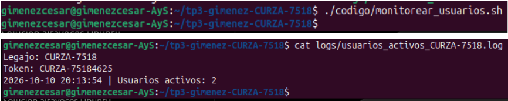

**Verificación de la acumulación de registros**

En esta segunda captura se muestra una nueva ejecución del script y la comprobación de que se agrega una línea al registro existente, sin eliminar los datos anteriores.

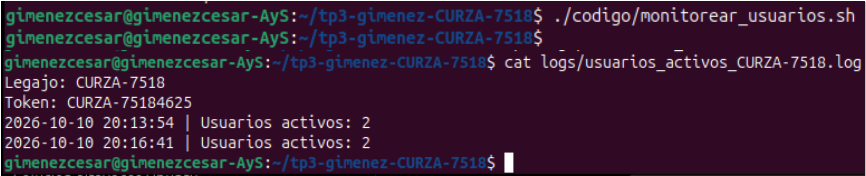

---

## 4. Actividad 2: Programación de tareas con at

### Objetivo

Crear un script que permita descargar un archivo desde una URL y programar su ejecución única para una fecha y hora determinadas.

### Archivo utilizado

`codigo/descarga_programada.sh`

El script recibe una URL como argumento y comprueba que se haya proporcionado correctamente y que utilice el protocolo HTTP o HTTPS.

Luego, crea el directorio `descargas/` si no existe y utiliza `wget` para guardar el archivo descargado en esa ubicación.

Si la descarga se completa, muestra un mensaje de éxito. Si ocurre un error, informa el problema y finaliza con un código de salida distinto de cero.

### Preparación del servicio

Se instaló la herramienta `at` y se habilitó su servicio:

```bash
sudo apt update
sudo apt install at
sudo systemctl enable --now atd
```

### Pruebas realizadas

Se comprobó el comportamiento del script en las siguientes situaciones:

- Ejecución sin argumentos.
- Uso de una dirección que no comienza con `http://` o `https://`.
- Descarga de un archivo ZIP desde una URL válida.
- Verificación de que el archivo descargado se encuentre en el directorio de destino.

### Programación de la descarga

Para programar una descarga de prueba a las 16:50, se utilizó:

```bash
echo '/home/gimenezcesar/tp3-gimenez-CURZA-7518/codigo/descarga_programada.sh https://github.com/github/gitignore/archive/refs/heads/main.zip' | at 16:50
```

La tarea quedó registrada en la cola de `at` y se ejecutó automáticamente a la hora indicada.

También se programó la descarga para el viernes 16 de octubre de 2026 a las 23:30:

```bash
echo '/home/gimenezcesar/tp3-gimenez-CURZA-7518/codigo/descarga_programada.sh https://github.com/github/gitignore/archive/refs/heads/main.zip' | at 23:30 2026-10-16
```

Para consultar las tareas pendientes se utiliza:

```bash
atq
```

### Verificación

Se comprobó que la descarga de prueba se ejecutara automáticamente y que el archivo resultante apareciera en `descargas/`.

Como el archivo `main.zip` ya existía, la segunda descarga se guardó como `main.zip.1`.

### Evidencias

**1. Ejecución sin argumentos**

Se comprueba que el script informe el uso correcto cuando no se proporciona una URL.

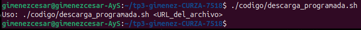

**2. Validación de la URL**

Se verifica que el script rechace una dirección que no comienza con `http://` o `https://`.

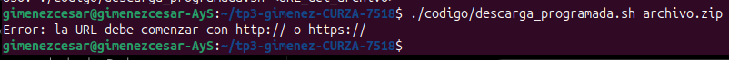

**3. Descarga mediante una URL válida**

Se comprueba que el script acepte una URL correcta y ejecute la descarga.

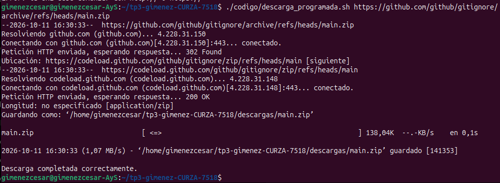

**4. Verificación del archivo descargado**

Se comprueba que el archivo descargado se encuentre en el directorio `descargas/`.

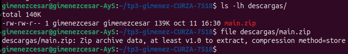

**5. Programación de una tarea con at**

Se muestra la programación de la descarga para una fecha y hora determinadas.

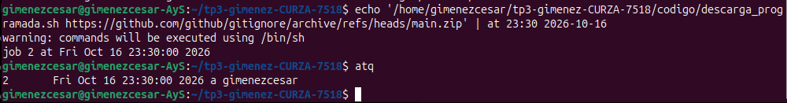

---

## 5. Actividad 3: Servicios y temporizadores con systemd

### Objetivo

Crear un servicio y un temporizador de systemd para comprobar periódicamente la conectividad de red con la puerta de enlace local.

### Script de diagnóstico

Archivo: `codigo/diagnostico_red.sh`

El script realiza una prueba de conectividad mediante `ping`, utilizando un único paquete y un tiempo máximo de espera de tres segundos.

La puerta de enlace identificada en el sistema es `10.0.2.2`, mediante la interfaz de red `enp0s3`.

El resultado se registra en:

`logs/ping_report_CURZA-7518.log`

Cada entrada contiene la fecha, la hora, la dirección de la puerta de enlace y el resultado de la prueba.

### Servicio systemd

Archivo: `config/monitoreo_CURZA-7518.service`

El servicio ejecuta el script de diagnóstico de red. Se configuró con `Type=oneshot`, ya que realiza una tarea puntual y finaliza después de registrar el resultado.

### Temporizador systemd

Archivo: `config/monitoreo_CURZA-7518.timer`

El temporizador se configuró para realizar la primera ejecución un minuto después del arranque y repetirla cada cinco minutos.

La configuración utilizada es:

```ini
[Unit]
Description=Temporizador de diagnostico de red CURZA-7518

[Timer]
OnBootSec=1min
OnUnitActiveSec=5min
Unit=monitoreo_CURZA-7518.service

[Install]
WantedBy=timers.target
```

### Activación y verificación

Los archivos se vincularon con systemd y se habilitó el temporizador:

```bash
sudo systemctl link /home/gimenezcesar/tp3-gimenez-CURZA-7518/config/monitoreo_CURZA-7518.service
sudo systemctl link /home/gimenezcesar/tp3-gimenez-CURZA-7518/config/monitoreo_CURZA-7518.timer
sudo systemctl daemon-reload
sudo systemctl enable --now monitoreo_CURZA-7518.timer
```

Para comprobar el estado del temporizador:

```bash
systemctl status monitoreo_CURZA-7518.timer --no-pager
```

Para consultar las próximas ejecuciones programadas:

```bash
systemctl list-timers --all | grep monitoreo_CURZA-7518
```

Para consultar los registros del servicio:

```bash
sudo journalctl -u monitoreo_CURZA-7518.service --no-pager -n 10
```

### Verificación

Se comprobó que el temporizador permaneciera activo y que el servicio se ejecutara correctamente.

El archivo de registro contiene entradas similares a la siguiente:

```text
2026-10-11 17:34:58 | Puerta de enlace: 10.0.2.2 | CONECTIVIDAD OK
```

### Evidencias

**Script de diagnóstico de red**

Se muestra la ejecución del script que comprueba la conectividad con la puerta de enlace.

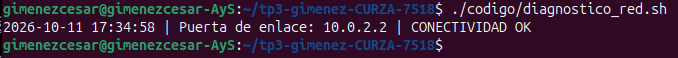

**Archivo del servicio**

Se muestra la configuración del servicio que ejecuta el diagnóstico de red.

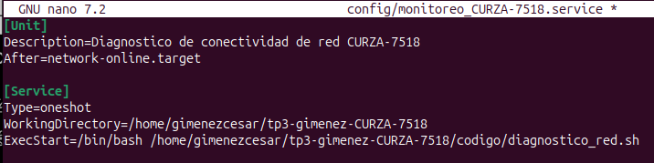

**Archivo del temporizador**

Se muestra la configuración del temporizador que programa las ejecuciones periódicas.

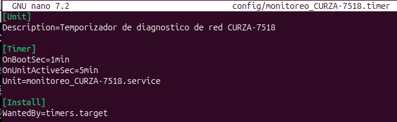

**Estado del temporizador**

Se verifica que el temporizador se encuentre activo y que tenga programada su próxima ejecución.

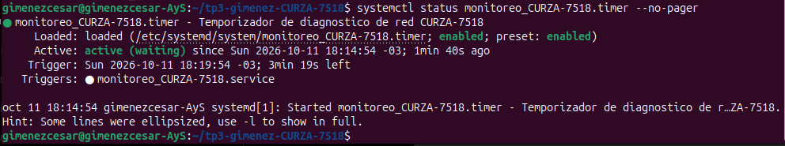

**Verificación de las ejecuciones automáticas**

Esta captura muestra el contenido del registro de conectividad y la consulta de los registros del servicio mediante `journalctl`. Permite comprobar que el diagnóstico se ejecuta periódicamente y que systemd registra sus ejecuciones.

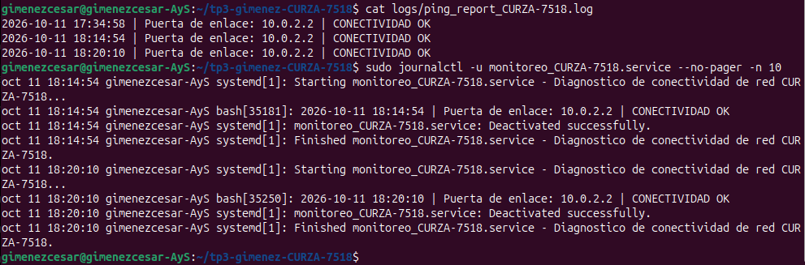

---

## 6. Actividad 4: Cambio seguro del hostname

### Objetivo

Desarrollar un script que permita cambiar el nombre del equipo, comprobando los permisos del usuario y validando el formato del nombre solicitado.

### Archivo utilizado

`codigo/cambiar_hostname.sh`

El script realiza las siguientes comprobaciones y operaciones:

1. Verifica que se ejecute con permisos de administrador mediante la variable `$EUID`.
2. Comprueba que se haya proporcionado exactamente un argumento.
3. Valida que el nombre siga el formato `curzas-alumno-[LEGAJO]`.
4. Obtiene el nombre anterior del equipo.
5. Actualiza el archivo `/etc/hostname`.
6. Actualiza las referencias al nombre anterior en `/etc/hosts`, cuando corresponde.
7. Informa el resultado de la operación.

### Pruebas de validación

Se realizaron pruebas para comprobar que el script rechazara las siguientes situaciones:

- Ejecución sin permisos de administrador.
- Ejecución sin argumentos.
- Uso de un nombre que no respeta el formato solicitado.

Estas pruebas permitieron verificar que el script informara los errores correspondientes antes de modificar la configuración del sistema.

### Cambio realizado

Antes de ejecutar el cambio, se crearon copias de seguridad de los archivos de configuración:

```bash
sudo cp /etc/hostname /etc/hostname.bak-tp3-CURZA-7518
sudo cp /etc/hosts /etc/hosts.bak-tp3-CURZA-7518
```

Luego, se ejecutó el script:

```bash
sudo ./codigo/cambiar_hostname.sh curzas-alumno-CURZA-7518
```

El nombre anterior era `gimenezcesar-AyS` y el nuevo nombre configurado fue `curzas-alumno-CURZA-7518`.

Para aplicar el cambio al hostname activo se utilizó:

```bash
sudo hostnamectl set-hostname curzas-alumno-CURZA-7518
```

### Verificación

Se comprobó el nombre activo con:

```bash
hostname
```

Y se consultó la configuración del sistema con:

```bash
hostnamectl
```

También se verificó que los archivos `/etc/hostname` y `/etc/hosts` reflejaran el cambio correspondiente.

### Evidencias

**Validación de permisos**

Se comprueba que el script no permita modificar la configuración sin permisos de administrador.

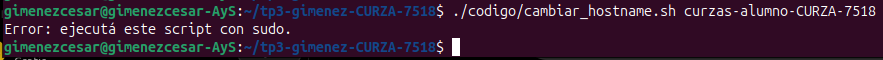

**Validación de argumentos**

Se comprueba que el script informe el uso correcto cuando no se proporciona el nombre del equipo.

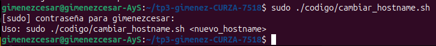

**Validación del formato**

Se comprueba que el script rechace un nombre que no cumple con el formato establecido.

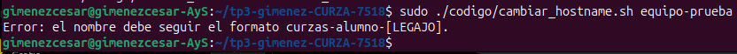

**Ejecución del cambio**

Se muestra la ejecución del script con permisos de administrador y el nuevo nombre solicitado.

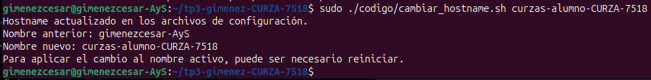

**Verificación del nuevo nombre**

Se comprueba que el nombre activo del equipo sea `curzas-alumno-CURZA-7518`.

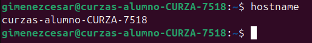

---

## 7. Actividad 5: Procesamiento de registros con awk

### Objetivo

Procesar un archivo de registros de sistema, identificar mensajes relacionados con errores y generar un informe organizado en columnas.

### Archivos utilizados

- Entrada: `recursos/syslog_prueba.txt`
- Script: `codigo/filtrar_errores.sh`
- Salida: `logs/reporte_errores_CURZA-7518.txt`

### Funcionamiento

El script comprueba primero que exista el archivo de entrada.

Luego utiliza `awk` para buscar registros que contengan las palabras `error`, `fail` o `critical`, sin distinguir entre mayúsculas y minúsculas.

Para cada coincidencia, extrae la fecha, la hora y el nombre del proceso. También elimina el PID numérico del nombre del proceso y limita el mensaje a un máximo de 50 caracteres.

Finalmente, genera un informe con las columnas `FECHA`, `HORA`, `PROCESO` y `MENSAJE`.

### Ejecución

Para generar el informe se utiliza:

```bash
./codigo/filtrar_errores.sh
```

Para consultar los resultados:

```bash
cat logs/reporte_errores_CURZA-7518.txt
```

### Verificación

La prueba se realizó utilizando un archivo de syslog de ejemplo con mensajes de distintos procesos y diferentes niveles de gravedad.

Se comprobó que el script detectara correctamente los siete registros esperados y generara el informe con las columnas correspondientes.

### Evidencia

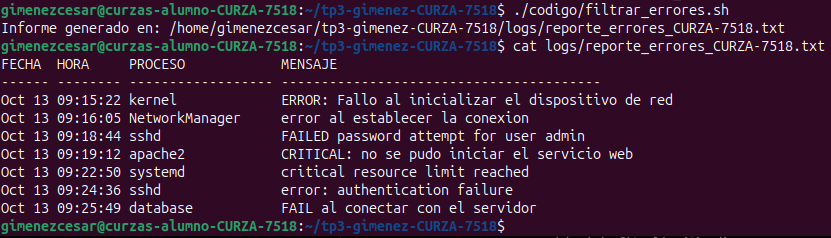

---

## 8. Conclusiones

A través de este trabajo práctico se aplicaron distintas herramientas de automatización y administración de sistemas GNU/Linux.

Cron permitió programar la ejecución periódica de un script para registrar las sesiones de usuario activas. La herramienta `at` permitió programar una tarea de ejecución única, mientras que systemd permitió crear un servicio y un temporizador para comprobar periódicamente la conectividad de red.

También se desarrolló un script para cambiar el hostname con validaciones de permisos y argumentos, y se utilizó `awk` para filtrar y organizar mensajes de error en un informe.

Las pruebas realizadas permitieron comprobar el funcionamiento de los scripts, las tareas programadas, el servicio y el temporizador, así como la generación de los archivos de registro.

En conjunto, las actividades permitieron practicar la automatización de tareas, la administración de servicios y el procesamiento de información desde la terminal de GNU/Linux.
